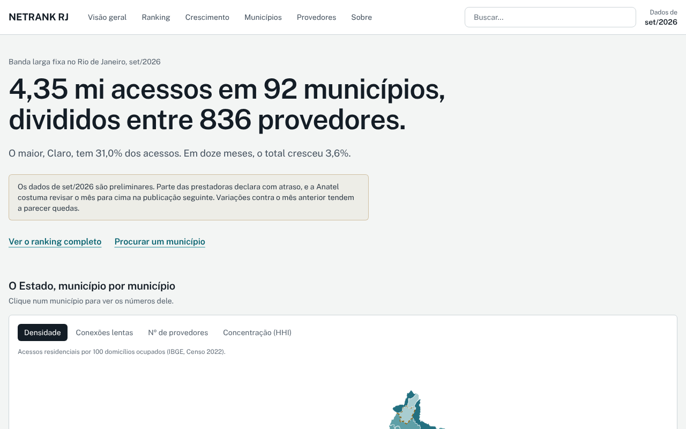
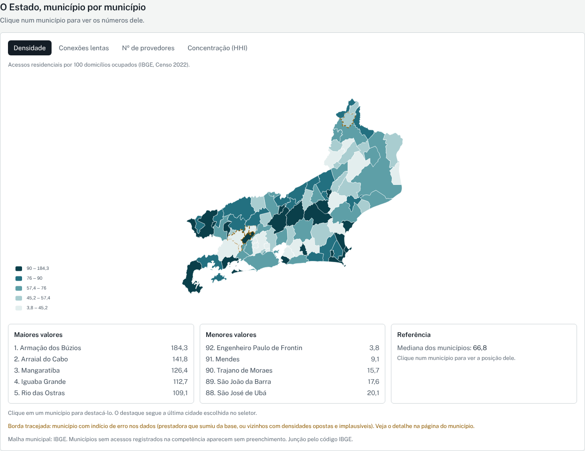
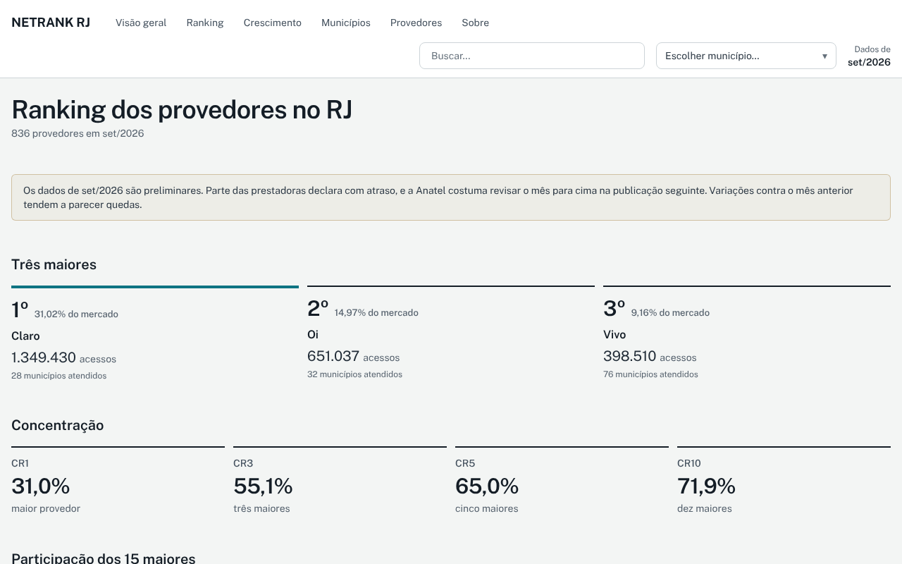
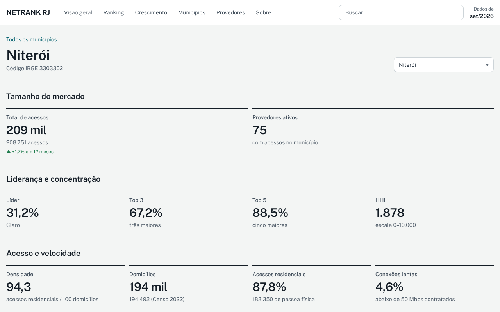
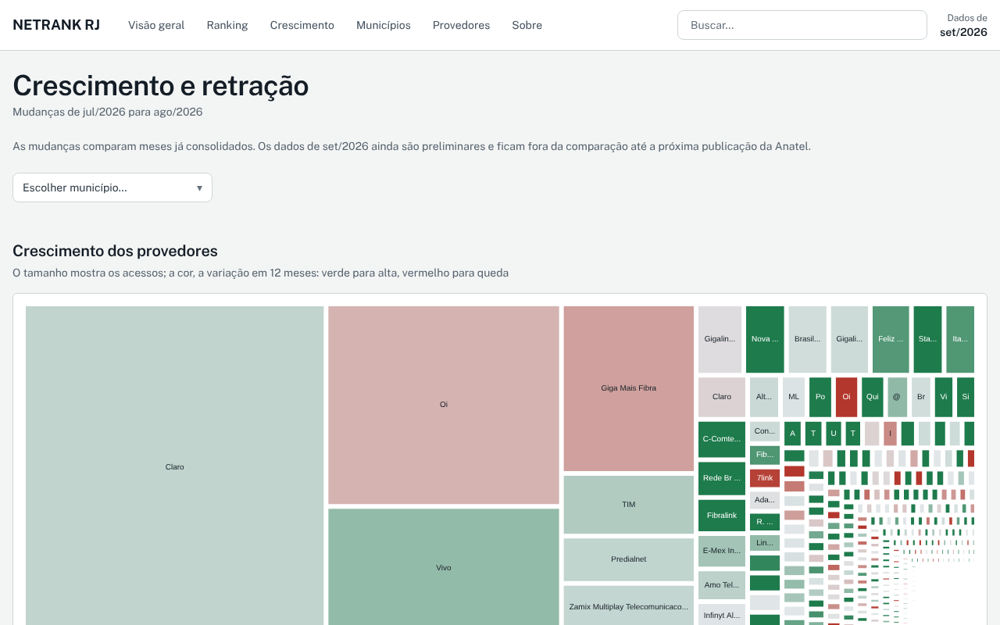
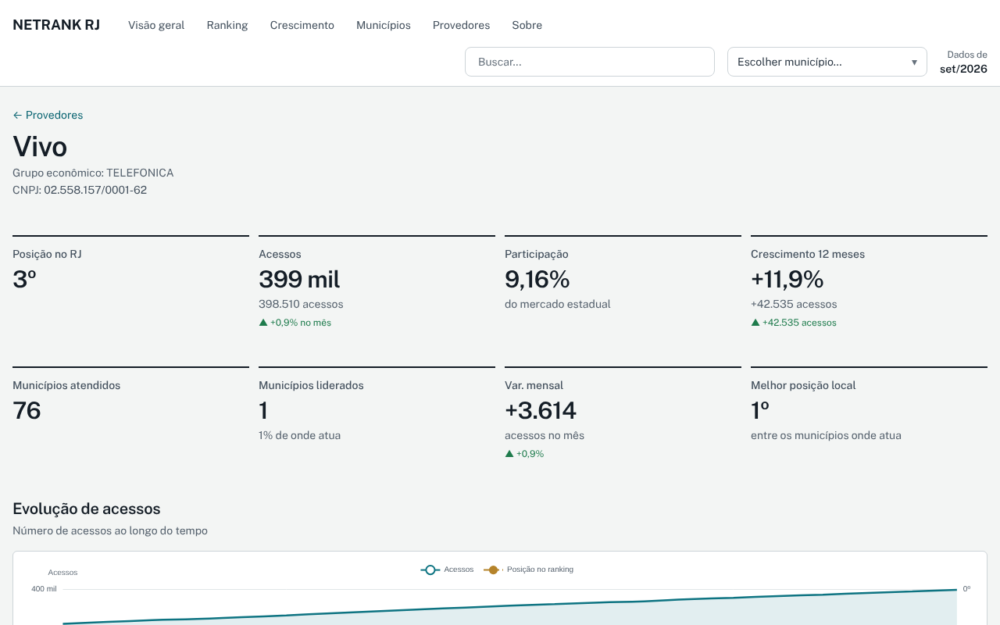
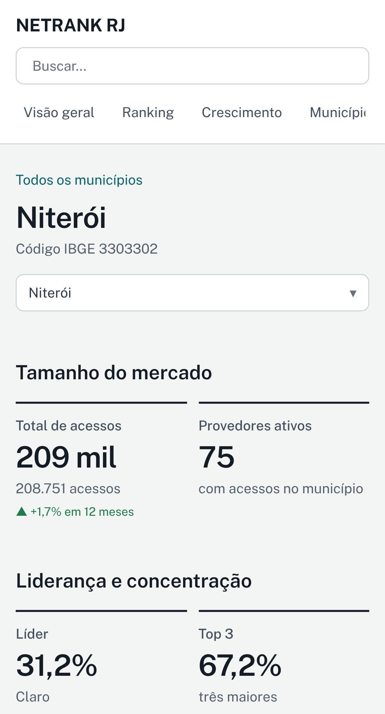
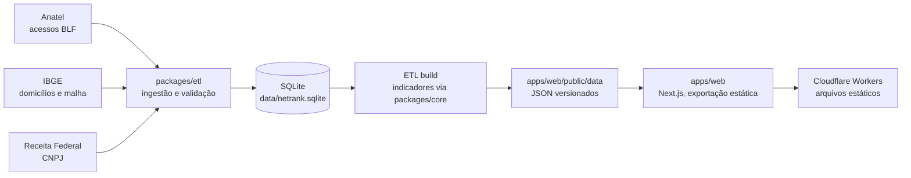

# NETRANK RJ

**Plataforma de Inteligência de Dados da Banda Larga Fixa no Estado do Rio de Janeiro**

[](https://doi.org/10.5281/zenodo.22839933)
[](https://orcid.org/0009-0009-7250-6151)
[](https://github.com/DaniloSFValim/rankingprovedoresrj/actions/workflows/ci.yml)
[](LICENSE-CODIGO)
[](LICENSE)

Painel publicado em [netranking-rj.labdados.org](https://netranking-rj.labdados.org).

## Sobre

O NETRANK RJ é uma plataforma independente de inteligência de dados sobre o mercado de
banda larga fixa fluminense, de autoria própria e finalidade acadêmica e de pesquisa. Ela
transforma os dados públicos de acessos de banda larga fixa dos 92 municípios do Estado do
Rio de Janeiro em rankings, indicadores, comparações e visualizações geográficas:
participação das prestadoras, concentração de mercado, distribuição territorial dos
acessos, evolução mensal, densidade de acessos por domicílio e velocidade contratada.

O NETRANK mede **acessos registrados**, não pessoas, domicílios atendidos nem cobertura
territorial da rede. Um domicílio pode ter mais de um acesso, e uma rede pode passar por
uma rua sem nenhum acesso contratado. Os textos usam "acessos", "distribuição" e
"participação", nunca "cobertura".

Usa exclusivamente dados públicos, citados com suas fontes e licenças. Não tem vínculo com
as instituições que publicam esses dados (Anatel, IBGE, Receita Federal) nem com qualquer
órgão público ou empresa. Os indicadores são estatísticos e não constituem conclusão
jurídica, concorrencial ou regulatória.

## Funcionalidades

- **Ranking estadual** de provedores por acessos, com participação, variação mensal e em 12
  meses, e indicadores de concentração (CR1, CR3, CR5, CR10 e HHI).
- **Mapa coroplético** dos municípios por densidade, conexões lentas, número de provedores
  e HHI, com zoom no município e comparação com os vizinhos.
- **Página de cada município**: tamanho do mercado, liderança, concentração, velocidade
  contratada, tecnologia, entradas e saídas de provedores, ranking local.
- **Página de cada provedor**: série histórica, posição no ranking e presença territorial.
- **Movimentações do mês**: quem ganhou e perdeu acessos, com filtros contra ruído (piso de
  base e exclusão de falhas de declaração).
- **Alertas de qualidade** dos dados declarados (saída abrupta de prestadora, densidade
  implausível), sinalizados no mapa e nas páginas, sem alterar nenhum número.
- **Dados para download**: os mesmos JSON que alimentam o site, sob CC BY 4.0.
- **Atualização mensal automática** a partir dos dados abertos da Anatel.

### Análises disponíveis

| Análise | Onde |
|---|---|
| Ranking de prestadoras por quantidade de acessos | `/ranking/`, ranking local em cada município |
| Participação relativa das prestadoras | Ranking, páginas de município e de provedor |
| Distribuição territorial dos acessos | Mapa da página inicial; presença por município na página do provedor |
| Comparações entre municípios | `/municipios/` e comparação com vizinhos na página do município |
| Evolução temporal | Série mensal do Estado, de cada município e de cada provedor; `/crescimento/` |
| Concentração de mercado | CR1, CR3, CR5, CR10 e HHI no Estado e em cada município |
| Visualizações geográficas | Mapa por densidade, conexões lentas, número de provedores e HHI |
| Diferenças na distribuição dos acessos | Densidade por domicílio, velocidade contratada e tecnologia por município |

### Capturas de tela

Telas do site publicado, com os dados de setembro de 2026.

| | |
|---|---|
|  |  |
| Página inicial | Mapa por densidade de acessos |
|  |  |
| Ranking estadual | Página de um município |
|  |  |
| Crescimento | Página de um provedor |



## Arquitetura

Monorepo npm com três pacotes. O ETL baixa e normaliza os dados públicos num warehouse
SQLite, calcula os indicadores e grava artefatos JSON versionados; o site Next.js os lê na
compilação e gera um site estático, publicado como arquivos estáticos num Cloudflare Worker.



Detalhes em [`docs/ARQUITETURA.md`](docs/ARQUITETURA.md).

## Tecnologias

| Camada | Tecnologia |
|---|---|
| Linguagem | TypeScript 5 (Node.js 20+) |
| Cálculo dos indicadores | `packages/core`, TypeScript puro, sem dependências |
| Ingestão | `packages/etl`: better-sqlite3, csv-parse, yauzl, iconv-lite; BigQuery como fonte alternativa |
| Site | Next.js 16 (exportação estática), React 19, Tailwind CSS 3, ECharts 6 |
| Testes | Vitest (unitários, componentes, integridade dos dados), Playwright e axe-core (navegador e acessibilidade) |
| Qualidade | ESLint 9, TypeScript estrito, validação de metadados de citação |
| Publicação | GitHub Actions e Cloudflare Workers (static assets) |

## Estrutura

```
packages/core     cálculo dos indicadores (participação, CR-n, HHI, ranking, competências)
packages/etl      ingestão, normalização, alertas de qualidade e geração dos artefatos
apps/web          site Next.js; e2e/ tem os testes de navegador
apps/web/public/data  artefatos JSON gerados pelo ETL (versionados)
data/             cadastros auxiliares versionados (IBGE, Receita, identidade das prestadoras)
docs/             arquitetura, dados e metodologia, desenvolvimento, padrões, auditoria
scripts/          verificação e atualização dos metadados de citação
```

## Como executar

Requer Node.js 20 ou superior. Num clone limpo, sem nenhuma credencial:

```bash
npm ci               # instala as dependências
npm run build        # gera o site estático em apps/web/out a partir dos dados versionados
npm run preview      # serve apps/web/out em http://localhost:3000
npm run dev          # servidor de desenvolvimento do Next.js
```

Para reprocessar os dados a partir das fontes públicas (precisa de rede e alguns GB livres):

```bash
npm run etl -- sincronizar   # descobre, baixa e importa os arquivos da Anatel
npm run etl -- municipios    # nomes oficiais dos municípios (IBGE)
npm run etl -- malhas        # malha municipal (IBGE)
npm run etl -- domicilios    # domicílios do Censo 2022 (IBGE/SIDRA)
npm run etl -- receita       # cadastro das prestadoras (dados abertos do CNPJ)
npm run etl -- build         # recalcula os artefatos JSON
npm run etl -- status        # estado do warehouse e alertas de qualidade
```

As variáveis de ambiente opcionais estão em [`.env.example`](.env.example). Nenhuma é
necessária para compilar ou testar o site.

## Testes e validação

```bash
npm run lint             # ESLint em todo o monorepo
npm run typecheck        # TypeScript nos três pacotes
npm test                 # unitários, componentes e integridade dos artefatos
npm run check-metadata   # CITATION.cff, .zenodo.json, versão, licença, DOI e ORCID
npm run build            # compilação do site
npm run test:e2e         # navegador: fluxos, acessibilidade WCAG 2.1 AA e celular (após o build)
npm run validar          # lint, typecheck, testes, metadados e build, em sequência
```

O CI (`.github/workflows/ci.yml`) roda todos esses passos a cada push e pull request.
Detalhes em [`docs/DESENVOLVIMENTO.md`](docs/DESENVOLVIMENTO.md).

## Dados e metodologia

| Fonte | Uso | Atualização |
|---|---|---|
| [Anatel, Acessos de Banda Larga Fixa](https://www.anatel.gov.br/dadosabertos/) | Acessos por prestadora, município, velocidade, tecnologia e tipo de pessoa | Mensal; coleta automática no dia 12 |
| [IBGE, Censo 2022, tabela 4712](https://sidra.ibge.gov.br/tabela/4712) | Domicílios particulares ocupados (denominador da densidade) | Fixa |
| [IBGE, Malha Municipal (API de malhas)](https://servicodados.ibge.gov.br/api/docs/malhas) | Geometria dos municípios no mapa | Fixa |
| Receita Federal, CNPJ (dados abertos, via BrasilAPI e Minha Receita) | Razão social, situação cadastral e porte das prestadoras | A cada 30 dias |

Período dos dados: janeiro de 2024 a setembro de 2026. O mês mais recente é preliminar: a
Anatel o revisa para cima na publicação seguinte.

Fontes, transformações, critérios, tratamento de lacunas e limitações conhecidas estão em
[`docs/DADOS.md`](docs/DADOS.md). As decisões de projeto estão em [`CONTEXT.md`](CONTEXT.md).

## Limitações conhecidas

- Os números são o que as prestadoras declaram à Anatel. Atrasos e erros de declaração
  aparecem no painel; os alertas de qualidade os sinalizam, mas nada é corrigido.
- A velocidade é a contratada, não a medida.
- A densidade é distorcida por domicílios de uso ocasional (municípios de veraneio) e por
  acessos registrados em outro município.

## Critérios de avaliação

| Critério | Onde verificar |
|---|---|
| Autoria | Histórico de commits, `CITATION.cff`, registro no Zenodo e ORCID (seção abaixo) |
| Arquitetura | [`docs/ARQUITETURA.md`](docs/ARQUITETURA.md): camadas, fluxo de dados e decisões |
| Funcionalidade | Site publicado e `npm run build && npm run preview` num clone limpo |
| Qualidade | `npm run validar`, `npm run test:e2e`, CI em `.github/workflows`, [`SECURITY.md`](SECURITY.md), [`docs/AUDITORIA.md`](docs/AUDITORIA.md) |
| Fundamentação científica | [`docs/DADOS.md`](docs/DADOS.md): fontes públicas, fórmulas, critérios, limitações e reprodução |

## Licença

- **Código-fonte:** [GNU Affero General Public License v3.0](LICENSE-CODIGO) (`AGPL-3.0-only`).
- **Documentação e dados processados:** [Creative Commons Atribuição 4.0](LICENSE) (`CC-BY-4.0`).

Os dados de origem seguem as licenças de seus publicadores (Anatel, IBGE e Receita Federal).

## Autoria

**Danilo Valim**, Universidade Federal Rural do Rio de Janeiro (UFRRJ).
ORCID: https://orcid.org/0009-0009-7250-6151

### Uso de inteligência artificial

O desenvolvimento contou com assistência de IA (Claude Code, da Anthropic) na escrita de
código, testes e documentação. Concepção, escolha das fontes, decisões de método, revisão
e validação são do autor. Detalhes em [`docs/USO-DE-IA.md`](docs/USO-DE-IA.md).

## Identificação acadêmica e citação

| | |
|---|---|
| DOI de conceito (todas as versões) | [10.5281/zenodo.22839933](https://doi.org/10.5281/zenodo.22839933) |
| DOI da versão 1.2.0 | [10.5281/zenodo.24312771](https://doi.org/10.5281/zenodo.24312771) |
| Registro no Zenodo | [zenodo.org/records/24312771](https://zenodo.org/records/24312771) |
| ORCID do autor | [0009-0009-7250-6151](https://orcid.org/0009-0009-7250-6151) |
| Versão citável | 1.2.0, publicada em 17/11/2026 |

Use o DOI de conceito para citar o projeto e o DOI de versão para citar exatamente a versão
usada.

> Valim, D. (2026). *NETRANK RJ: Plataforma de Inteligência de Dados da Banda Larga Fixa no
> Estado do Rio de Janeiro* (versão 1.2.0) [Software]. Zenodo. https://doi.org/10.5281/zenodo.22839933

```bibtex
@software{valim_netrank_rj_2026,
  author    = {Valim, Danilo},
  title     = {{NETRANK RJ}: Plataforma de Inteligência de Dados da Banda Larga Fixa no Estado do Rio de Janeiro},
  year      = {2026},
  version   = {1.2.0},
  publisher = {Zenodo},
  doi       = {10.5281/zenodo.22839933},
  url       = {https://doi.org/10.5281/zenodo.22839933}
}
```

Os metadados de citação estão em [`CITATION.cff`](CITATION.cff) (o GitHub gera APA e BibTeX
no botão *Cite this repository*) e em [`.zenodo.json`](.zenodo.json), usado pelo Zenodo ao
arquivar cada release do GitHub.
