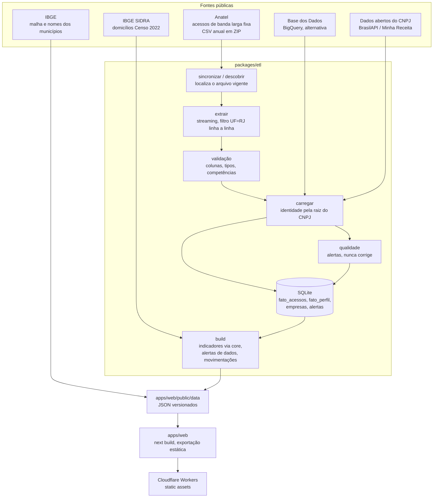
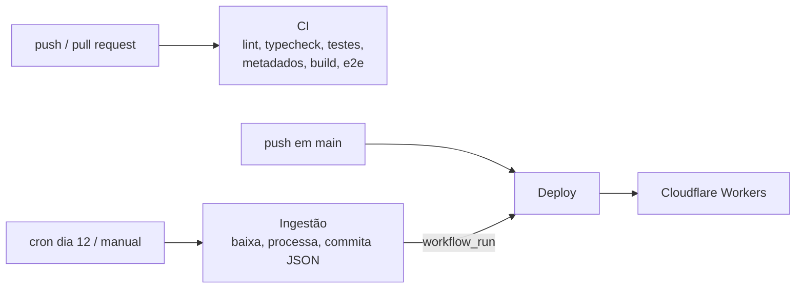

# Arquitetura

O NETRANK RJ é um monorepo npm (workspaces) com três pacotes e nenhum servidor de
aplicação: todo o processamento acontece na ingestão, e o site publicado é estático.

## Componentes

| Pacote | Responsabilidade | Depende de |
|---|---|---|
| `packages/core` | Cálculo puro dos indicadores: participação de mercado, CR-n, HHI, ranking com empates, variações, competências, normalização de nomes. Sem I/O. | nada |
| `packages/etl` | Ingestão das fontes públicas, validação, normalização, warehouse SQLite, alertas de qualidade e geração dos artefatos JSON. CLI em `src/cli.ts`. | `core` |
| `apps/web` | Site Next.js com exportação estática. Lê os artefatos JSON no build e gera uma página por município e por provedor. | `core` (tipos e funções de formatação de competência) |

A separação garante que a mesma função calcula um indicador no ETL e nos testes, e que o
site nunca recalcula nada: ele só apresenta o que o ETL gravou.

## Fluxo de dados

### Etapas

1. **Descoberta e download.** `sincronizar` consulta o inventário aberto da Anatel (e, se
   houver chave, o catálogo dados.gov.br) para achar o arquivo vigente, baixa o ZIP e o
   guarda sem modificação em `data/raw/`.
2. **Extração.** O CSV nacional é lido em streaming e filtrado para UF = RJ linha a linha,
   sem carregar o arquivo inteiro em memória. A codificação é detectada (UTF-8 ou Latin-1).
3. **Validação.** Linhas com competência inválida, código IBGE inválido, empresa sem nome ou
   acessos não numéricos são rejeitadas e contadas por motivo; uma taxa de rejeição alta gera
   alerta.
4. **Normalização e carga.** Cada prestadora é identificada pela raiz do CNPJ (8 dígitos);
   sem CNPJ, pelo nome normalizado, com alerta. A carga substitui só as competências
   presentes no lote: a série histórica nunca é truncada.
5. **Qualidade.** Alertas de competência vazia, variação anormal, empresa nova ou
   desaparecida, lacuna na série e tecnologia não mapeada. O módulo só observa e registra.
6. **Build dos artefatos.** Para a competência mais recente, calcula ranking, concentração,
   séries, perfil de velocidade, densidade (com os domicílios do Censo), movimentações e
   alertas de dados por município, e grava os JSON em `apps/web/public/data`.
7. **Site.** `next build` gera HTML estático para todas as rotas a partir dos JSON.
8. **Publicação.** O workflow Deploy publica `apps/web/out` no Cloudflare Workers.

## Artefatos

| Arquivo | Conteúdo |
|---|---|
| `meta.json` | Procedência (fonte, URL, arquivo, datas de coleta e processamento), competências e lacunas |
| `estado/kpis.json` | Totais, líder, concentração e variações do Estado |
| `estado/ranking.json` | Ranking estadual completo |
| `estado/serie.json` | Série mensal do Estado (lacuna = `null`, nunca zero) |
| `movimentacoes.json` | Movimentações do mês consolidado |
| `municipios/index.json`, `municipios/<slug>.json` | Índice e perfil de cada município |
| `provedores/index.json`, `provedores/<slug>.json` | Índice e perfil de cada provedor |
| `malhas/rj-municipios.json` | Malha municipal (GeoJSON) |

Os artefatos são versionados para que um clone limpo compile o site sem rede e sem
credenciais. A integridade deles é verificada pelos testes em
`packages/etl/src/__tests__/integridade-artefatos.test.ts`.

## Automação

| Workflow | Gatilho | Função |
|---|---|---|
| `ci.yml` | push e pull request | Lint, typecheck, testes, metadados, build e testes de navegador |
| `security.yml` | push, pull request, diário | `npm audit` e CodeQL |
| `dados-reais.yml` | dia 12 de cada mês e manual | Ingestão das fontes públicas e commit dos artefatos |
| `deploy.yml` | push em `main` e fim da ingestão | Build e publicação; recusa dados demonstrativos |

## Decisões de arquitetura

- **Site estático.** Não há API, banco de dados nem autenticação em produção. A superfície de
  ataque se reduz a arquivos estáticos com cabeçalhos de segurança (`apps/web/public/_headers`).
- **SQLite como warehouse.** Arquivo único, portável e reprodutível; o SQL é próximo do ANSI.
- **Artefatos versionados.** O histórico do Git registra o que foi publicado em cada
  competência e permite reproduzir o site sem refazer a ingestão.
- **Nada é corrigido automaticamente.** Erros de declaração viram alertas visíveis; os números
  publicados são sempre os declarados à Anatel.

As decisões de método (pisos, mês preliminar, alertas) estão em [`CONTEXT.md`](../CONTEXT.md).
